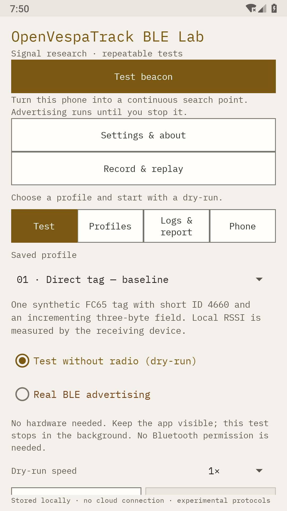
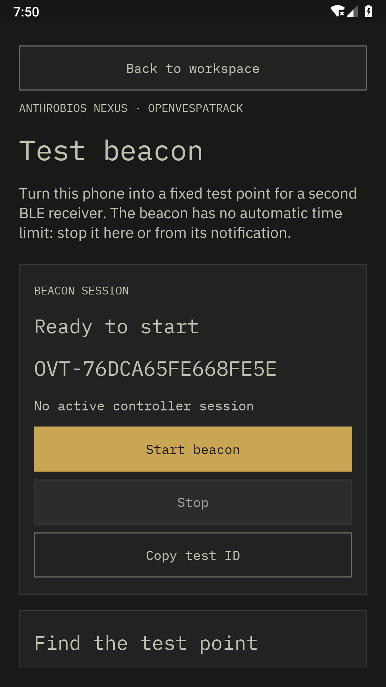
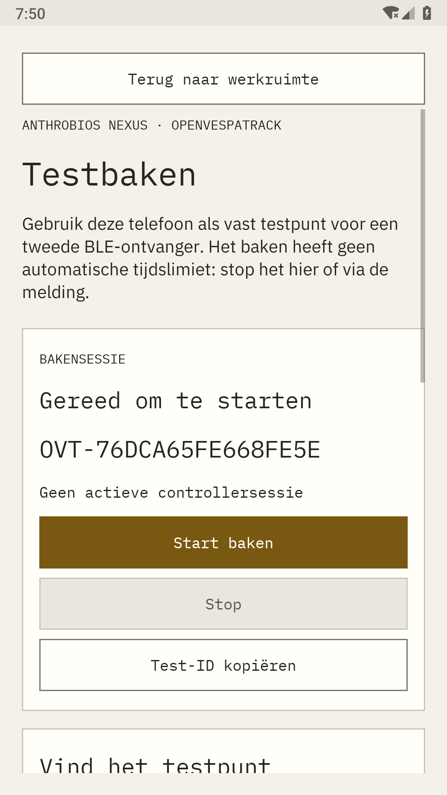
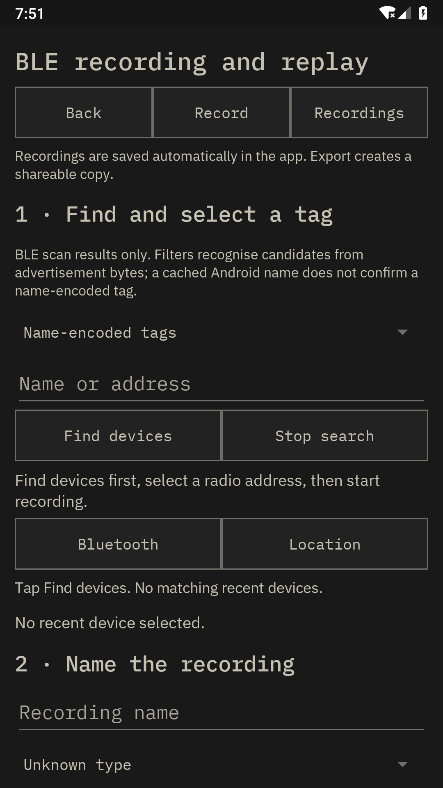
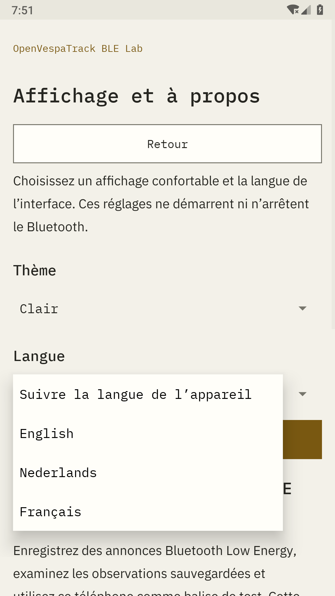

# OpenVespaTrack BLE Lab

An Android workbench for a **continuous test beacon**, BLE recordings and controlled advertisement replay. Part of [OpenVespaTrack](https://www.anthrobiosnexus.com/projects/openvespatrack/), an [AnthroBios Nexus](https://www.anthrobiosnexus.com/) project.

OpenVespaTrack aims to make a fully open-source hornet tracking system accessible worldwide at the lowest practical cost. BLE Lab supports its first phase: testing receivers and understanding signals from existing tags. It is a test and research app; it does not calculate a tag's location.

**Release candidate: 0.4.0-rc.2.** Android 8.0/API 26 or later. Live BLE advertising requires a compatible phone and Bluetooth permissions.

## Download and install

**[Download Android preview APK · 0.4.0-rc.2](https://github.com/benjaminvdz/openvespatrack-ble-lab/releases/download/v0.4.0-rc.2/openvespatrack-ble-lab-0.4.0-rc.2-preview.apk)**

Open **[GitHub Releases](https://github.com/benjaminvdz/openvespatrack-ble-lab/releases)** and download the APK attached to the selected release. Read its preview status and signing information, then compare its checksum with the accompanying SHA-256 file. GitHub's automatic source archives are for developers.

1. Export important recordings and profiles before upgrading.
2. Open the downloaded APK on your Android phone. Grant installation permission to the app used to open it if Android asks.
3. Launch **OpenVespaTrack BLE Lab**, then choose your language and appearance under **Settings & about**.
4. Enable Bluetooth before a radio test. Permissions are requested when the relevant feature is used.

A preview APK may use a development signing certificate. Android accepts an in-place upgrade only when the existing installation has the same application ID and signing certificate. Export important data before a deliberate reinstall. See [installation and updates](docs/INSTALLATION.md).

## Choose the right tool

| Task | Mode | Behaviour |
| --- | --- | --- |
| Leave a fixed signal for another receiver to find | **Test beacon** | One synthetic identity, without a scenario deadline, until Stop or a reported interruption |
| Inspect a real device | **Record & replay** | Explicit device selection, original scan bytes and local RSSI, automatic local storage |
| Review a recording | Offline playback | Review saved observations without transmitting |
| Reconstruct supported recorded content | Controlled replay | Review a timed profile; transmission requires a separate explicit start |
| Test a protocol pattern | Timed simulation | Deterministic synthetic profiles, pauses, counters and payload RSSI |
| Explore without radio hardware | Dry-run | Run a scenario without radio calls while the app stays visible |

The test beacon uses its own service-data identity. It does not imitate an existing tag, change the phone's Bluetooth name or promise a fixed Bluetooth address. Use an all-BLE or matching service-data filter on the receiver. [Beacon tutorial](docs/tutorials.md#use-a-phone-as-a-test-beacon)

## Interface

- AnthroBios Nexus **light, dark and system** appearances.
- **English, Dutch and French** interfaces and tutorials.
- A separate test-beacon screen with identity, elapsed time, state and Stop.
- Foreground notifications for real radio activity, with a Stop action.
- Original recordings and session evidence remain independent of UI translations and appearance settings.

## Screenshots

Actual native app captures, with the beacon stopped and no live scan. The test ID is synthetic.



| Test beacon · dark / English | Test beacon · light / Nederlands |
| --- | --- |
|  |  |

| Recording workspace | Appearance and language · Français |
| --- | --- |
|  |  |

The [screenshot record](docs/screenshots/README.md) lists their build and capture conditions. Screenshots are not physical radio-validation evidence.

## Start here

- **[English tutorials](docs/tutorials.md)**
- **[Nederlandse handleiding](docs/tutorials-nl.md)**
- **[Guide et tutoriels en français](docs/tutorials-fr.md)**
- [Full operating guide](docs/USAGE.md)
- [Installation, updates and backup](docs/INSTALLATION.md)

## What the radio status means

An Android acceptance callback means the controller accepted a request. Only an independent receiver confirms reception. RSSI is measured at the receiver; it does not establish distance, bearing or location.

The test beacon has no automatic scenario end. Screen-off and leaving its screen do not intentionally stop it. Bluetooth-off, revoked permissions, force-stop, reboot, process termination or vendor battery restrictions can interrupt it. Radio activity never resumes automatically after a process restart.

Timed name-encoded profiles can temporarily change the phone's general Bluetooth name through a guarded restore flow. This is separate from the test beacon. See [radio behaviour and field tests](docs/HARDWARE.md).

## Build and test

Use JDK **17**, Android SDK **36** and Build Tools **36.0.0**. The Gradle wrapper checks its distribution checksum; dependency versions are pinned.

```sh
./gradlew --no-daemon :core:test :app:testDebugUnitTest :app:lintDebug :app:assembleDebug :app:assembleRelease
# With a connected Android test device or emulator:
./gradlew --no-daemon :app:connectedDebugAndroidTest
python3 scripts/publication_audit.py
```

Set `ANDROID_HOME` to your SDK, or use an untracked `local.properties`. An unsigned release assembly is a build check, not an installable download. [Validation status](docs/TESTING.md)

## Documentation and contribution

[Architecture](docs/ARCHITECTURE.md) · [Protocol](docs/PROTOCOL.md) · [Profiles](docs/PROFILES.md) · [Exports](docs/EXPORTS.md) · [Field acceptance](docs/TEST_MATRIX.md) · [Contributing](CONTRIBUTING.md) · [Security](SECURITY.md)

Application code is licensed under **[MIT](LICENSE)**, copyright Benjamin van der Zalm. IBM Plex fonts and other components retain their own licenses; see [NOTICE](NOTICE). The Android package identity is retained for upgrade continuity.

[OpenVespaTrack and project updates](https://www.anthrobiosnexus.com/projects/openvespatrack/) · [BLE Tagfinder desktop companion](https://github.com/benjaminvdz/openvespatrack-ble-tagfinder)
